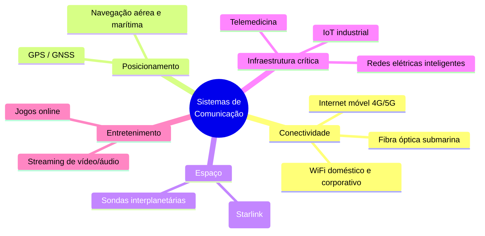
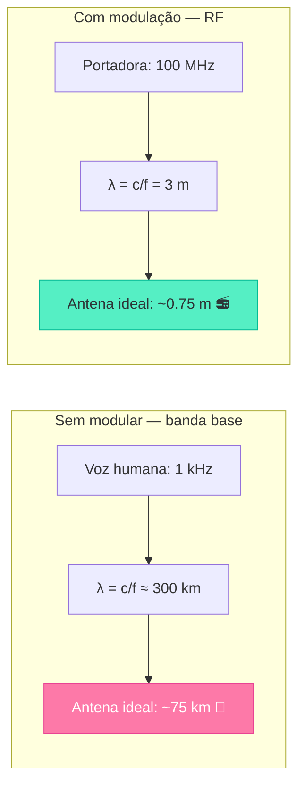
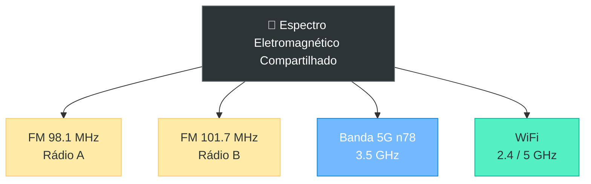
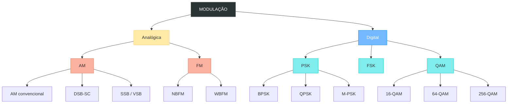
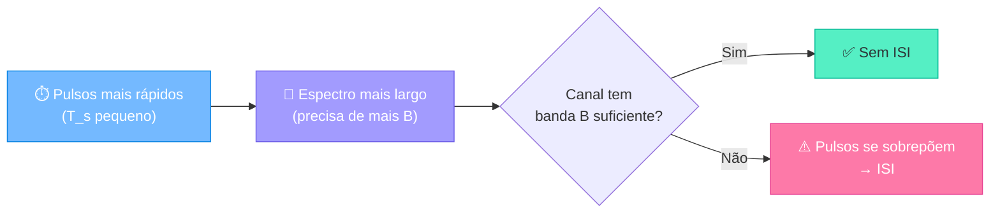

# Sistemas de Comunicações

> **Prof. Laio Oriel Seman** · UFSC · 2026/2 · 180 horas

---


## Sumário da Aula

1. Apresentação da disciplina
2. O que é comunicar?
3. A cadeia de comunicação — modelo completo
4. Modulação — guia visual
5. Experiências Python ao vivo
6. Métricas fundamentais
7. Roteiro do semestre
8. Metodologia e avaliação

---


## Apresentação da Disciplina

### Bem-vindo a Sistemas de Comunicações!

Esta disciplina responde a uma pergunta aparentemente simples:

> **Como enviamos informação de um ponto a outro?**

A resposta esconde uma das mais ricas áreas da engenharia.

---

### Por que esta disciplina importa?

- Cada chamada VoIP, vídeo no YouTube, GPS, e-mail — tudo usa **sistemas de comunicação**
- 5G, Starlink, WiFi 7, satélites LEO — baseiam-se nos conceitos daqui
- A teoria das comunicações é onde **matemática pura** se traduz em **tecnologia tangível** que bilhões usam diariamente

---

### A comunicação move o mundo moderno

Praticamente todo valor econômico digital depende de bits atravessando algum canal físico — e alguém precisou **projetar** esse trecho da jornada.



> Sem engenharia de comunicações, não há Internet, não há satélites, não há telefone celular. É uma das disciplinas de engenharia com **maior impacto direto per capita** no planeta.

---

### O problema central: recursos são escassos

Todo sistema de comunicação disputa **três recursos fundamentais**, sempre limitados:

| Recurso | Limitação | Exemplo |
|---|---|---|
| **Espectro (Hz)** | Regulado, finito, caro | Leilão de espectro 5G: bilhões de dólares |
| **Potência (W)** | Bateria, regulação, saúde | Celular: poucos watts; sonda espacial: miliwatts |
| **Tempo (s)** | Latência tolerável | Cirurgia remota: < 10 ms; e-mail: segundos |

>! O trabalho do engenheiro de comunicações é **extrair o máximo de informação confiável** desses três recursos escassos — e a teoria de Shannon nos diz exatamente qual é o limite teórico desse jogo.

---

### Pré-requisitos

| Pré-requisito | Por que importa |
|---|---|
| Cálculo (integrais, Fourier) | Fourier é a linguagem dos sinais |
| Álgebra Linear (vetores, matrizes) | Constelações QAM/PSK são vetores |
| Probabilidade e Estatística | Ruído = processo aleatório |
| Circuitos Elétricos (filtros) | Moduladores = filtros e misturadores |

---


## Ementa e Objetivos

### Ementa

> **Introdução a sistemas de comunicações; Modulação analógica; Formatação e transmissão de sinais em banda base; Transmissão digital em banda passante; Equalização; Sincronismo.**

---

### Objetivos Gerais

Ao final do semestre, você será capaz de:

1. **Compreender** a cadeia completa de comunicação — da fonte ao destino
2. **Projetar** moduladores e demoduladores (AM, FM, BPSK, QPSK, QAM)
3. **Analisar** o desempenho com ruído (SNR, $E_b/N_0$, BER)
4. **Calcular** a capacidade máxima de um canal (Shannon)
5. **Implementar** receptores digitais completos em Python
6. **Projetar** equalizadores para combater distorção do canal
7. **Implementar** mecanismos de sincronismo (fase, timing, quadro)

---

### Estrutura do Semestre (80 horas)

| Módulo | Tópico | Aprox. |
|---|---|---|
| **I** | Introdução a sistemas | ~10h |
| **II** | Modulação analógica (AM, FM) | ~16h |
| **III** | Banda base — Nyquist, ISI | ~10h |
| **IV** | Digital banda passante | ~16h |
| **V** | Equalização (ZF, MMSE, LMS) | ~10h |
| **VI** | Sincronismo (Costas, Gardner) | ~10h |
| **VII** | Códigos corretores de erros | ~8h |

---


## O que é Comunicar?

### Definição fundamental

Comunicar é **transferir informação de um emissor a um receptor por um meio imperfeito**.

>! O "meio imperfeito" é a chave!

Nenhum canal é perfeito. Sempre há:

- **Ruído** (térmico, interferência, multipercursos)
- **Atenuação** (o sinal perde força com a distância)
- **Distorção** (diferentes frequências viajam diferente)
- **Interferência** (outros transmissores no mesmo espectro)

---

### A arte das comunicações

> A engenharia de comunicações é a arte de **extrair informação máxima de sinais mínimos, através de canais ruins**.

---

### Exemplos do mundo real

| Sistema | Canal | Modulação | Desafio principal |
|---|---|---|---|
| WiFi (802.11ac) | Rádio multipercursos | 256-QAM | ISI, sincronismo |
| GPS (L1) | Espaço livre, ultra fraco | BPSK | Sensibilidade extrema |
| 5G NR | Urbano/vehicular | OFDM + 64-QAM | Mobilidade, latência |
| Fiber optic | Fibra óptica | PPM / QAM | Dispersão cromática |
| Ham radio | Rádio AM/FM | AM / FM | Ruído, alcance |

---


## A Cadeia de Comunicação


---

### Fonte — Entropia de Shannon

::: definição
A **entropia de Shannon** mede a informação contida em uma fonte:
$$H(X) = -\sum_{i} p_i \log_2(p_i) \quad \text{(bits/símbolo)}$$
:::

- Moeda justa ($p=0.5$): $H = 1$ bit/símbolo
- Moeda viciada ($p=0.99$): $H \approx 0.08$ bits/símbolo — quase tudo previsível

---

### Codificação de Fonte

Remove redundância.

- Exemplos: Huffman, ZIP, MP3, JPEG
- **Objetivo:** transmitir a mesma informação com **menos bits**

---

### Codificação de Canal

Adiciona redundância **controlada** para proteção.

- Exemplo: código Hamming $(7,4)$ — 4 bits viram 7
- **Objetivo:** detectar e corrigir erros sem retransmissão

---

### Modulador

Adapta o sinal à banda do canal.

$$s(t) = I(t)\cos(2\pi f_c t) - Q(t)\sin(2\pi f_c t)$$

Um sinal de voz (3.4 kHz) não viaja por uma antena de 1 m. Precisamos "carregá-lo" em uma portadora de MHz ou GHz.

---

### Canal

O meio físico: fio, fibra, espaço livre.

$$r(t) = s(t) * h(t) + n(t)$$

Sempre adiciona:
- **Atenuação** (perda de potência)
- **Ruído** (aleatório, modelado como Gaussiano)
- **Distorção** (multipercursos, ISI)

---


## Modulação — Guia Visual Completo

### Por que modular?

Modulação é o processo de **transladar** um sinal de informação (banda base, baixa frequência) para uma faixa de frequências mais alta, centrada em uma **portadora** $f_c$. Sem isso, a comunicação moderna simplesmente não existiria.

1. **Antenas práticas**: $\lambda = c/f$ — áudio 1 kHz → antena de 75 km! Portadora 100 MHz → antena de 0.75 m
2. **FDM**: diferentes transmissores em faixas diferentes (FM 98.1, 101.7 MHz)
3. **Imunidade a ruído**: FM e PSK trocam banda por qualidade
4. **Eficiência espectral**: QAM e OFDM carregam muitos bits por Hertz
5. **Multiplexação do meio**: várias fontes compartilham o mesmo canal físico sem colidir
6. **Propagação**: baixas frequências não atravessam a ionosfera nem viajam bem no espaço livre; altas frequências sim

---

### Antenas: o argumento mais visceral

A antena eficiente tem dimensão da ordem de $\lambda/4$ a $\lambda/2$, onde $\lambda = c/f$.



>! Sem modulação, seu rádio de bolso precisaria de uma antena do tamanho de uma cidade. A portadora de RF resolve isso ao "empacotar" a informação em uma frequência com comprimento de onda prático.

---

### Modulação também organiza o espectro

Além de viabilizar antenas pequenas, modular permite que **múltiplos sinais compartilhem o mesmo meio físico** (ar, cabo, fibra) sem se sobrepor — cada estação de rádio, canal de TV ou operadora de celular ocupa sua própria fatia de frequência.



Isso é **FDM** (Frequency Division Multiplexing): cada sinal modulado numa portadora diferente, todos coexistindo sem interferir — desde que respeitem sua faixa alocada.

---

### O que varia?

Modular é **codificar informação em uma portadora** alterando:

- **Amplitude** → AM, ASK, QAM
- **Frequência** → FM, FSK
- **Fase** → PSK, QAM

---



---


## Modulações Analógicas — AM

### AM Convencional (com portadora)

O que varia: **amplitude** proporcional à mensagem.

$$s_{\text{AM}}(t) = A_c\,[1 + \mu\,m(t)]\,\cos(2\pi f_c t)$$

$\mu$ = índice de modulação ($0 \le \mu \le 1$ para evitar sobremodulação)

---

| Propriedade | Valor |
|---|---|
| **Banda** | $B = 2f_m$ |
| **Potência total** | $P_T = P_c\,(1 + \mu^2/2)$ |
| **Eficiência** | Máx. 33% (quando $\mu=1$) |
| **Demodulação** | Envelope simples — sem portadora local |
| **Imunidade a ruído** | Baixa |
| **Aplicações** | Rádio AM comercial (530–1700 kHz) |

---

### DSB-SC (Carrier Suppressed)

Mesma fórmula, **sem portadora** — economiza potência.

$$s_{\text{DSB-SC}}(t) = A_c\,m(t)\,\cos(2\pi f_c t)$$

| Propriedade | Valor |
|---|---|
| **Banda** | $B = 2f_m$ |
| **Potência** | 100% nas bandas laterais |
| **Demodulação** | **Coerente** — precisa de portadora local síncrona |
| **Problema** | Ambiguidade de fase de 180° |

---

### SSB e VSB

::: definição
**SSB** (Single Sideband): envia apenas uma banda lateral.
$$s_{\text{SSB}}(t) = \frac{A_c}{2}\,m(t)\cos(2\pi f_c t) \mp \frac{A_c}{2}\,\hat{m}(t)\sin(2\pi f_c t)$$
onde $\hat{m}(t)$ é a transformada de Hilbert.

**VSB** (Vestigial Sideband): uma banda lateral completa + parte da outra.
$$B = f_m + f_{\text{vestígio}}$$
:::

| Tipo | Banda | Demodulação | Aplicações |
|---|---|---|---|
| **SSB** | $f_m$ (metade!) | Coerente | Rádio amador, HF |
| **VSB** | $\approx f_m$ | Coerente (menos crítica) | TV analógica (NTSC, PAL) |

---

### Comparação Visual AM

<!-- slides: columns -->

### AM Convencional

- Envelope segue $m(t)$
- Portadora sempre presente
- Demodulação simples (diodo)
- Pouco eficiente em potência

<!-- slides: column -->

### DSB-SC

- Zero crossing quando $m(t)$ cruza zero
- 100% potência nas laterais
- Precisa demodulação coerente
- Mais eficiente em potência

<!-- slides: end-columns -->

---

### Visualize AM em Python

```python
import numpy as np
import matplotlib.pyplot as plt

fs = 44100
t = np.linspace(0, 0.01, int(0.01 * fs), endpoint=False)
f_msg = 440
f_carrier = 5000
mu = 0.7

m = np.sin(2 * np.pi * f_msg * t)
carrier = np.cos(2 * np.pi * f_carrier * t)

am = (1 + mu * m) * carrier
dsb = m * carrier

fig, axes = plt.subplots(3, 1, figsize=(14, 5))

axes[0].plot(t[:200], m[:200], '#2563eb', lw=1.5)
axes[0].set_ylabel('Mensagem'); axes[0].set_title('Mensagem — 440 Hz'); axes[0].grid(alpha=0.3)

axes[1].plot(t[:200], am[:200], '#dc2626', lw=1.5)
axes[1].set_ylabel('AM'); axes[1].set_title(f'AM Convencional (μ={mu}) — envelope segue m(t)'); axes[1].grid(alpha=0.3)

axes[2].plot(t[:200], dsb[:200], '#047857', lw=1.5)
axes[2].set_xlabel('Tempo (s)'); axes[2].set_ylabel('DSB-SC')
axes[2].set_title('DSB-SC — note os zero-crossings quando m(t) cruza zero'); axes[2].grid(alpha=0.3)

plt.tight_layout(); plt.savefig('am_visual.png', dpi=150, bbox_inches='tight')
print("AM: envelope segue m(t)" )
print("DSB-SC: 100% potência nas laterais (sem portadora)")
```

>! **AM**: envelope segue a mensagem (demodulação simples).
> **DSB-SC**: sem portadora — 100% eficiente em potência.

---


## Modulações Analógicas — FM

### FM Convencional (Wideband FM)

O que varia: **frequência instantânea** proporcional à mensagem.

$$s_{\text{FM}}(t) = A_c\,\cos\!\left(2\pi f_c t + 2\pi k_f \!\int_0^t m(\tau)\,d\tau\right)$$

Índice de modulação FM: $\beta = \Delta f / f_m$

---

### Regra de Carson

$$\boxed{B_{\text{FM}} \approx 2\,f_m\,(1 + \beta)}$$

| Propriedade | Valor |
|---|---|
| **Banda** | $2f_m(1+\beta)$ — pode ser muito maior que AM |
| **Imunidade a ruído** | **Excelente** — receptor rejeita amplitude |
| **Ganho de processamento** | $\text{SNR}_{\text{out}} = \frac{3}{2}\beta^2 \cdot \text{SNR}_{\text{in}}$ |
| **Efeito limiar** | ~10 dB — abaixo disso, colapso catastrófico |
| **Aplicações** | Rádio FM (88–108 MHz, $\beta \approx 5$) |

---

### NBFM vs WBFM

| Propriedade | NBFM | WBFM |
|---|---|---|
| **Índice $\beta$** | $\ll 1$ (tip. 0.2) | Grande (tip. 5) |
| **Banda** | $\approx 2f_m$ | $\gg 2f_m$ |
| **Qualidade de áudio** | Voz (3 kHz) | Hi-Fi (15 kHz) |
| **Imunidade** | Moderada | Excelente |

> NBFM ≈ DSB-SC em banda. WBFM troca banda por imunidade a ruído.

---

### Visualize FM em Python

```python
import numpy as np
import matplotlib.pyplot as plt

fs = 44100
t = np.linspace(0, 0.005, int(0.005 * fs), endpoint=False)
f_msg = 440
f_carrier = 5000
beta = 2.0

m = np.sin(2 * np.pi * f_msg * t)
carrier = np.cos(2 * np.pi * f_carrier * t)

am = (1 + 0.7 * m) * carrier
fm = np.cos(2 * np.pi * f_carrier * t + beta * np.sin(2 * np.pi * f_msg * t))

fig, axes = plt.subplots(3, 1, figsize=(14, 5))

axes[0].plot(t[:150], m[:150], '#2563eb', lw=1.5)
axes[0].set_ylabel('Mensagem'); axes[0].set_title('Mensagem — 440 Hz'); axes[0].grid(alpha=0.3)

axes[1].plot(t[:150], am[:150], '#dc2626', lw=1.5)
axes[1].set_ylabel('AM'); axes[1].set_title(f'AM (μ=0.7) — amplitude varia'); axes[1].grid(alpha=0.3)

axes[2].plot(t[:150], fm[:150], '#047857', lw=1.5)
axes[2].set_xlabel('Tempo (s)'); axes[2].set_ylabel('FM')
axes[2].set_title(f'FM (β={beta}) — amplitude constante, frequência varia!'); axes[2].grid(alpha=0.3)

plt.tight_layout(); plt.savefig('fm_visual.png', dpi=150, bbox_inches='tight')
print(f"FM: freq. varia entre {f_carrier-beta*f_msg:.0f} e {f_carrier+beta*f_msg:.0f} Hz")
print(f"FM: amplitude = {np.abs(fm).mean():.4f} (quase constante!)")
```

>! **FM**: amplitude constante — densidade das oscilações muda.
> **AM**: amplitude varia — fácil de demodular.

---


## Modulações Digitais — PSK

### BPSK (Binary PSK)

2 fases possíveis: $0$ e $\pi$.

| Bit | Fase | Portadora |
|---|---|---|
| 0 | $0$ | $+\cos(2\pi f_c t)$ |
| 1 | $\pi$ | $-\cos(2\pi f_c t)$ |

$$s_0(t) = \sqrt{\frac{2E_b}{T_b}}\cos(2\pi f_c t), \qquad s_1(t) = -\sqrt{\frac{2E_b}{T_b}}\cos(2\pi f_c t)$$

| Propriedade | Valor |
|---|---|
| **Bits/símbolo** | $k = 1$ |
| **BER** | $P_b = Q\!\left(\sqrt{\dfrac{2E_b}{N_0}}\right)$ |
| **Eb/N₀ para BER=10⁻⁵** | ≈ 9.6 dB |
| **Robustez** | **Máxima** |

---

### QPSK (Quadrature PSK)

4 fases: $\pi/4,\, 3\pi/4,\, 5\pi/4,\, 7\pi/4$ (Gray coding).

| Bits | Fase | Ponto |
|---|---|---|
| 00 | $\pi/4$ | $(+1, +1)$ |
| 01 | $3\pi/4$ | $(-1, +1)$ |
| 11 | $5\pi/4$ | $(-1, -1)$ |
| 10 | $7\pi/4$ | $(+1, -1)$ |

| Propriedade | Valor |
|---|---|
| **Bits/símbolo** | $k = 2$ |
| **Eficiência espectral** | $\eta = 1.0$ bit/s/Hz |
| **BER** | $P_b \approx Q\!\left(\sqrt{\dfrac{2E_b}{N_0}}\right)$ |
| **Eb/N₀ para BER=10⁻⁵** | ≈ 12.6 dB |

> QPSK dobra a eficiência do BPSK com BER similar!

---

### M-PSK

Generalização: $M$ fases equidistantes ($2\pi/M$).

$$P_b \approx \frac{2}{\log_2 M}\,Q\!\left(\sqrt{2\log_2 M \cdot \dfrac{E_b}{N_0}}\,\sin\!\frac{\pi}{M}\right)$$

| M | $k$ | Eb/N₀ para BER=10⁻⁵ |
|---|---|---|
| 2 (BPSK) | 1 | **9.6 dB** |
| 4 (QPSK) | 2 | 12.6 dB |
| 8 | 3 | 16.3 dB |
| 16 | 4 | 19.6 dB |

>! **Regra prática**: Cada dobra de M custa ~3 dB. Depois de QPSK, PSK torna-se impraticável — entra a QAM.

---

### Visualize PSK em Python

```python
import numpy as np
import matplotlib.pyplot as plt

fig, axes = plt.subplots(1, 3, figsize=(16, 4))

# BPSK constelação
ax = axes[0]
ax.scatter([-1], [0], s=300, c='#dc2626', edgecolors='white', linewidth=3, zorder=3)
ax.scatter([1], [0], s=300, c='#dc2626', edgecolors='white', linewidth=3, zorder=3)
ax.text(-1, -0.2, '0 (π)', ha='center', fontsize=14, weight='bold', color='white')
ax.text(1, -0.2, '1 (0)', ha='center', fontsize=14, weight='bold', color='white')
ax.set_xlim(-1.5, 1.5); ax.set_ylim(-1, 1)
ax.axhline(0, color='gray', lw=0.5, alpha=0.5); ax.axvline(0, color='gray', lw=0.5, alpha=0.5)
ax.set_xlabel('In-Fase (I)'); ax.set_ylabel('Quadrature (Q)')
ax.set_title('BPSK — 2 pontos → 1 bit/símbolo', color='#dc2626'); ax.grid(alpha=0.3); ax.set_aspect('equal')

# QPSK constelação
ax = axes[1]
pts = np.array([[-1,-1], [-1,1], [1,1], [1,-1]])
ax.scatter(pts[:, 0], pts[:, 1], s=300, c='#047857', edgecolors='white', linewidth=3, zorder=3)
for (x, y), lbl in zip(pts, ['00', '01', '11', '10']):
    ax.text(x, y*1.15, lbl, ha='center', fontsize=12, weight='bold', color='white')
ax.set_xlim(-1.5, 1.5); ax.set_ylim(-1.5, 1.5)
ax.axhline(0, color='gray', lw=0.5, alpha=0.5); ax.axvline(0, color='gray', lw=0.5, alpha=0.5)
ax.set_xlabel('In-Fase (I)'); ax.set_ylabel('Quadrature (Q)')
ax.set_title('QPSK — 4 pontos → 2 bits/símbolo', color='#047857'); ax.grid(alpha=0.3); ax.set_aspect('equal')

# BER comparison
ax = axes[2]
from scipy.special import erfc
EbN0_lin = np.logspace(-1, 2, 500)
EbN0_dB = 10 * np.log10(EbN0_lin)
ax.semilogy(EbN0_dB, 0.5*erfc(np.sqrt(EbN0_lin)), lw=3, label='BPSK', color='#dc2626')
ax.semilogy(EbN0_dB, 0.5*erfc(np.sqrt(EbN0_lin)), lw=3, ls='--', label='QPSK', color='#047857')
ax.axhline(1e-5, color='red', ls='--', alpha=0.3)
ax.set_xlabel('Eb/N₀ (dB)'); ax.set_ylabel('BER')
ax.set_title('BER Teórico — BPSK ≈ QPSK'); ax.legend(); ax.grid(True, alpha=0.3, which='both')

plt.tight_layout(); plt.savefig('psk_visual.png', dpi=150, bbox_inches='tight')
print("BPSK: 2 pontos → robusto")
print("QPSK: 4 pontos → 2x mais bits/símbolo")
```

>! **BPSK**: 2 fases (0, π) — mais robusto.
> **QPSK**: 4 fases — dobra eficiência com BER similar.

---


## Modulações Digitais — FSK

### BFSK (Binary FSK)

| Bit | Frequência |
|---|---|
| 0 | $f_0 = f_c - \Delta f$ |
| 1 | $f_1 = f_c + \Delta f$ |

| Propriedade | Valor |
|---|---|
| **Banda** | $B \approx 2\Delta f + 2/T_b$ |
| **Coerente** | $P_b = Q\!\left(\sqrt{\dfrac{E_b}{N_0}}\right)$ |
| **Não-coerente** | $P_b = \tfrac{1}{2}\exp\!\left(-\dfrac{E_b}{2N_0}\right)$ |
| **Custo vs BPSK** | ~3 dB pior (coerente) |

> **Vantagem**: Não requer sincronismo de fase! Mais simples de implementar.
> **Aplicações**: Modems V.22, pager, IoT (LoRa), RFID UHF

---

### Visualize FSK em Python

```python
import numpy as np
import matplotlib.pyplot as plt

fs = 44100
t = np.linspace(0, 0.02, int(0.02 * fs), endpoint=False)
f0 = 4000
f1 = 6000

np.random.seed(42)
bits = np.random.randint(0, 2, 20)

s0 = np.cos(2 * np.pi * f0 * t)
s1 = np.cos(2 * np.pi * f1 * t)

fsk = np.zeros_like(t)
step = len(t) // len(bits)
for i, bit in enumerate(bits):
    start = i * step
    end = min((i + 1) * step, len(t))
    fsk[start:end] = s0[start:end] if bit == 0 else s1[start:end]

fig, axes = plt.subplots(2, 1, figsize=(14, 6))

ax = axes[0]
ax.stem(range(len(bits)), bits, linefmt='#2563eb', markerfmt='o', basefmt='gray')
ax.set_xlabel('Símbolo'); ax.set_ylabel('Bit')
ax.set_title('Bits enviados (sequência de 20 bits)')
ax.set_ylim(-0.2, 1.2); ax.grid(alpha=0.3)

ax = axes[1]
t_short = np.linspace(0, 0.01, int(0.01 * fs), endpoint=False)
ax.plot(t_short, fsk[:len(t_short)], '#ea580c', lw=1)
ax.set_xlabel('Tempo (s)'); ax.set_ylabel('Amplitude')
ax.set_title(f'BFSK — {f0} Hz (bit 0) vs {f1} Hz (bit 1)')
ax.grid(alpha=0.3)

plt.tight_layout(); plt.savefig('bfsk_visual.png', dpi=150, bbox_inches='tight')
print(f"BFSK: bit 0 → {f0} Hz, bit 1 → {f1} Hz")
print("spacing:", abs(f1-f0), "Hz")
```

## Modulações Digitais — ASK / OOK

### OOK (On-Off Keying)

| Bit | Sinal |
|---|---|
| 0 | $0$ (sem transmissão) |
| 1 | $A_c\cos(2\pi f_c t)$ |

$$P_b = Q\!\left(\sqrt{\dfrac{E_b}{2N_0}}\right)$$

| Propriedade | Valor |
|---|---|
| **Custo vs BPSK** | ~3 dB pior |
| **Simplicidade** | **Máxima** — basta ligar/desligar |
| **Aplicações** | Controle remoto IR, fibra óptica, RFID passivo |

---

### Visualize OOK em Python

```python
import numpy as np
import matplotlib.pyplot as plt

fs = 44100
t = np.linspace(0, 0.02, int(0.02 * fs), endpoint=False)
fc = 5000
carrier = np.cos(2 * np.pi * fc * t)

np.random.seed(42)
bits = np.random.randint(0, 2, 20)

ook = np.zeros_like(t)
step = len(t) // len(bits)
for i, bit in enumerate(bits):
    start = i * step
    end = min((i + 1) * step, len(t))
    ook[start:end] = bits[i] * carrier[start:end]

fig, axes = plt.subplots(3, 1, figsize=(14, 7))

ax = axes[0]
ax.stem(range(len(bits)), bits, linefmt='#2563eb', markerfmt='o', basefmt='gray')
ax.set_xlabel('Símbolo'); ax.set_ylabel('Bit')
ax.set_title('Bits enviados')
ax.set_ylim(-0.2, 1.2); ax.grid(alpha=0.3)

ax = axes[1]
t_short = np.linspace(0, 0.01, int(0.01 * fs), endpoint=False)
ax.plot(t_short, carrier[:len(t_short)], '#64748b', lw=0.8, alpha=0.7)
ax.set_ylabel('Portadora')
ax.set_title('Portadora — 5 kHz'); ax.grid(alpha=0.3)

ax = axes[2]
t_short = np.linspace(0, 0.01, int(0.01 * fs), endpoint=False)
ax.plot(t_short, ook[:len(t_short)], '#dc2626', lw=1)
ax.set_xlabel('Tempo (s)'); ax.set_ylabel('OOK')
ax.set_title('OOK — ligar (1) / desligar (0)'); ax.grid(alpha=0.3)

plt.tight_layout(); plt.savefig('ook_visual.png', dpi=150, bbox_inches='tight')
print("OOK: bit 1 → portadora ON, bit 0 → OFF")
print("BER pior que BPSK por ~3 dB")
```

>! **OOK**: o mais simples — basta ligar/desligar a portadora.
> **Desvantagem**: ~3 dB pior que BPSK.

---


## Modulações Digitais — QAM

### M-QAM Quadrada

Grid $\sqrt{M} \times \sqrt{M}$ no plano I/Q.

$$s(t) = I\cos(2\pi f_c t) - Q\sin(2\pi f_c t)$$

| M | Nome | Grid | Bits/símbolo | Eb/N₀ BER=10⁻⁵ |
|---|---|---|---|---|
| 4 | 4-QAM (= QPSK) | 2×2 | 2 | ~12.6 dB |
| 16 | 16-QAM | 4×4 | 4 | ~19.6 dB |
| 64 | 64-QAM | 8×8 | 6 | ~26 dB |
| 256 | 256-QAM | 16×16 | 8 | ~32 dB |
| 1024 | 1024-QAM | 32×32 | 10 | ~38 dB |

**BER aproximada**:
$$P_b \approx \frac{4}{\log_2 M}\left(1 - \frac{1}{\sqrt{M}}\right) Q\!\left(\sqrt{\frac{3\log_2 M}{M-1}\cdot\frac{E_b}{N_0}}\right)$$

> **Regra prática**: ~6 dB por dobro de M.

---

### Visualize QAM em Python

```python
import numpy as np
import matplotlib.pyplot as plt

fig, axes = plt.subplots(1, 2, figsize=(16, 5))

ax = axes[0]
levels_16 = np.array([-1.5, -0.5, 0.5, 1.5])
ii, jj = np.meshgrid(levels_16, levels_16)
pts_16 = np.column_stack([ii.ravel(), jj.ravel()])
ax.scatter(pts_16[:, 0], pts_16[:, 1], s=200, c='#9333ea', edgecolors='white', lw=2, zorder=3)
ax.set_xlim(-2, 2); ax.set_ylim(-2, 2)
ax.axhline(0, color='gray', lw=0.5, alpha=0.5); ax.axvline(0, color='gray', lw=0.5, alpha=0.5)
ax.set_xlabel('In-Fase (I)'); ax.set_ylabel('Quadrature (Q)')
ax.set_title('16-QAM — 4×4 grid\n4 bits/símbolo\nBER ~19.6 dB', color='#9333ea')
ax.grid(alpha=0.3); ax.set_aspect('equal')

ax = axes[1]
levels_64 = np.array([-3, -2, -1, 0, 1, 2, 3, 4]) * 0.5
ii, jj = np.meshgrid(levels_64, levels_64)
pts_64 = np.column_stack([ii.ravel(), jj.ravel()])
ax.scatter(pts_64[:, 0], pts_64[:, 1], s=100, c='#ea580c', edgecolors='white', lw=0.8, alpha=0.8, zorder=3)
ax.set_xlim(-2, 2); ax.set_ylim(-2, 2)
ax.axhline(0, color='gray', lw=0.5, alpha=0.5); ax.axvline(0, color='gray', lw=0.5, alpha=0.5)
ax.set_xlabel('In-Fase (I)'); ax.set_ylabel('Quadrature (Q)')
ax.set_title('64-QAM — 8×8 grid\n6 bits/símbolo\nBER ~26 dB', color='#ea580c')
ax.grid(alpha=0.3); ax.set_aspect('equal')

plt.tight_layout(); plt.savefig('qam_constellations.png', dpi=150, bbox_inches='tight')
print(f"16-QAM: {len(pts_16)} pontos → 4 bits/símbolo → Eb/N₀ ~19.6 dB")
print(f"64-QAM: {len(pts_64)} pontos → 6 bits/símbolo → Eb/N₀ ~26 dB")
print("Quanto mais pontos, mais sensível a ruído!")
```

>! **QAM**: combina amplitude E fase — mais eficiente, mas mais sensível a ruído.
> **Regra**: ~6 dB por dobro de M.

---


## Tabela Comparativa

| Modulação | Tipo | O que varia | Eb/N₀ BER=10⁻⁵ | Eficiência |
|---|---|---|---|---|
| **AM conv** | Analógica | Amplitude | — | 33% pot. |
| **SSB** | Analógica | Amplitude | — | 100% pot. |
| **WBFM** | Analógica | Frequência | — | Excelente ruído |
| **OOK** | Digital | Amplitude | ~12.6 dB | 0.5 b/s/Hz |
| **BPSK** | Digital | Fase | **9.6 dB** | 0.5 b/s/Hz |
| **QPSK** | Digital | Fase+Ampl. | **12.6 dB** | **1.0 b/s/Hz** |
| **16-QAM** | Digital | Fase+Ampl. | ~19.6 dB | **4.0 b/s/Hz** |
| **64-QAM** | Digital | Fase+Ampl. | ~26 dB | **6.0 b/s/Hz** |
| **256-QAM** | Digital | Fase+Ampl. | ~32 dB | **8.0 b/s/Hz** |

---


## O Grande Trade-off


- **BPSK**: máximo em robustez, mínimo em eficiência
- **256-QAM**: máximo em eficiência, mínimo em robustez
- **QPSK**: o "ponto doce" — bom equilíbrio

> Sistemas espaciais (Voyager) usam BPSK — sinal a bilhões de km com watts.
> Sistemas de banda larga (WiFi 6) usam 256-QAM — velocidade, não distância.

---


## Experiências Python ao Vivo

```python
import numpy as np
import matplotlib.pyplot as plt

fs = 44100
t = np.linspace(0, 0.05, int(0.05 * fs), endpoint=False)
f_msg = 440
f_carrier = 5000
mu = 0.7
beta = 2.0

m = np.sin(2 * np.pi * f_msg * t)
carrier = np.cos(2 * np.pi * f_carrier * t)

am = (1 + mu * m) * carrier
fm = np.cos(2 * np.pi * f_carrier * t + beta * np.sin(2 * np.pi * f_msg * t))

fig, axes = plt.subplots(3, 1, figsize=(12, 6))

axes[0].plot(t[:500], m[:500], '#2563eb', lw=1)
axes[0].set_ylabel('Mensagem'); axes[0].set_title(f'Mensagem — {f_msg} Hz')

axes[1].plot(t[:500], am[:500], '#dc2626', lw=1)
axes[1].set_ylabel('AM'); axes[1].set_title(f'AM (μ={mu})')

axes[2].plot(t[:500], fm[:500], '#047857', lw=1)
axes[2].set_xlabel('Tempo (s)'); axes[2].set_ylabel('FM')
axes[2].set_title(f'FM (β={beta}) — amplitude constante, frequência varia!')

plt.tight_layout()
plt.savefig('am_vs_dsb.png', dpi=150, bbox_inches='tight')
print("AM: envelope segue m(t)")
print(f"FM: freq. varia entre {f_carrier-beta*f_msg:.0f} e {f_carrier+beta*f_msg:.0f} Hz")
```

>! **AM**: envelope segue a mensagem. **FM**: amplitude constante, densidade das oscilações muda.

---

```python
import numpy as np
import matplotlib.pyplot as plt
from scipy.special import erfc

np.random.seed(42)

fig, axes = plt.subplots(2, 3, figsize=(18, 6))

# Constelações
ax = axes[0, 0]
ax.scatter([-1], [0], s=300, c='#dc2626', ec='white', lw=3)
ax.text(-1, -0.2, '0', ha='center', fontsize=14, weight='bold', color='white')
ax.scatter([1], [0], s=300, c='#dc2626', ec='white', lw=3)
ax.text(1, -0.2, '1', ha='center', fontsize=14, weight='bold', color='white')
ax.set_xlim(-1.5, 1.5); ax.set_ylim(-1, 1)
ax.set_title('BPSK — 1 bit/símbolo', color='#dc2626'); ax.grid(alpha=0.3)

ax = axes[0, 1]
pts = np.array([[-1,-1], [-1,1], [1,1], [1,-1]])
ax.scatter(pts[:, 0], pts[:, 1], s=300, c='#047857', ec='white', lw=3)
ax.set_xlim(-1.5, 1.5); ax.set_ylim(-1.5, 1.5)
ax.set_title('QPSK — 2 bits/símbolo', color='#047857'); ax.grid(alpha=0.3)

ax = axes[0, 2]
levels = np.array([-1.5, -0.5, 0.5, 1.5])
ii, jj = np.meshgrid(levels, levels)
ax.scatter(ii.ravel(), jj.ravel(), s=200, c='#9333ea', ec='white', lw=2)
ax.set_xlim(-2, 2); ax.set_ylim(-2, 2)
ax.set_title('16-QAM — 4 bits/símbolo', color='#9333ea'); ax.grid(alpha=0.3)

ax = axes[1, 0]
levels64 = np.linspace(-3, 3, 8) * 0.5
ii, jj = np.meshgrid(levels64, levels64)
ax.scatter(ii.ravel(), jj.ravel(), s=100, c='#ea580c', ec='white', lw=0.8, alpha=0.8)
ax.set_xlim(-2, 2); ax.set_ylim(-2, 2)
ax.set_title('64-QAM — 6 bits/símbolo', color='#ea580c'); ax.grid(alpha=0.3)

ax = axes[1, 1]
EbN0_lin = np.logspace(-1, 2, 500)
EbN0_dB = 10 * np.log10(EbN0_lin)
ax.semilogy(EbN0_dB, 0.5*erfc(np.sqrt(EbN0_lin)), lw=2.5, label='BPSK/QPSK', color='#2563eb')
ax.semilogy(EbN0_dB, (3/8)*erfc(np.sqrt(0.4*EbN0_lin)), lw=2.5, label='16-QAM', color='#047857')
ax.semilogy(EbN0_dB, 0.5*erfc(np.sqrt(EbN0_lin/2)), lw=2.5, label='OOK', color='#dc2626')
ax.axhline(1e-5, color='red', ls='--', alpha=0.3)
ax.set_xlabel('Eb/N₀ (dB)'); ax.set_ylabel('BER')
ax.set_title('BER Teórico'); ax.legend(); ax.grid(True, alpha=0.3, which='both')

ax = axes[1, 2]
ax.text(0.5, 0.5, 'BER para 10⁻⁵:', ha='center', fontsize=12, weight='bold', transform=ax.transAxes)
ax.text(0.5, 0.35, 'BPSK: 9.6 dB', ha='center', fontsize=11, transform=ax.transAxes)
ax.text(0.5, 0.25, 'QPSK: 12.6 dB', ha='center', fontsize=11, transform=ax.transAxes)
ax.text(0.5, 0.15, '16-QAM: 19.6 dB', ha='center', fontsize=11, transform=ax.transAxes)
ax.text(0.5, 0.05, '64-QAM: 26.0 dB', ha='center', fontsize=11, transform=ax.transAxes)
ax.set_axis_off()

plt.tight_layout()
plt.savefig('todas_modulacoes.png', dpi=150, bbox_inches='tight')
print("Constelações e BER geradas!")
```

---

```python
import numpy as np

fs = 44100
t = np.linspace(0, 0.05, int(0.05 * fs))
f_msg, f_carrier = 440, 5000
mu, beta = 0.7, 2.0

m = np.sin(2*np.pi*f_msg*t)
am = (1 + mu*m) * np.cos(2*np.pi*f_carrier*t)
fm = np.cos(2*np.pi*f_carrier*t + beta*np.sin(2*np.pi*f_msg*t))

N = len(t)
f = np.fft.fftfreq(N, 1/fs)

am_fft = 2/N * np.abs(np.fft.fft(f > 0))
fm_fft = 2/N * np.abs(np.fft.fft(f > 0))

print(f"AM: 3 picos — portadora + LSB + USB")
print(f"FM: Múltiplas laterais (Bessel)")
print(f"Banda FM ≈ 2·f_msg·(1+β) = {2*f_msg*(1+beta)} Hz")
```

>! **AM**: 3 componentes (portadora ± lateral). **FM**: múltiplas bandas laterais (funções de Bessel).

---

```python
import numpy as np

np.random.seed(42)
fs = 44100
t = np.linspace(0, 0.02, int(0.02 * fs))
s = np.cos(2*np.pi*5000*t)

for snr in [20, 10, 3, -3]:
    sigma = np.sqrt(0.5 / 10**(snr/10))
    n = np.random.normal(0, sigma, len(t))
    r = s + n
    print(f"SNR={snr:3d} dB → σ={sigma:.4f} — sinal {'limpo' if snr>10 else 'visível' if snr>0 else 'perdido'} no ruído")
```

| SNR | Estado do sinal |
|---|---|
| 20 dB | Praticamente limpo |
| 10 dB | Ruído visível |
| 3 dB | Quase invisível |
| −3 dB | Mais fraco que o ruído — impossível sem código |

---


## Métricas Fundamentais

### As grandezas que importam

| Grandeza | Símbolo | Fórmula | O que diz |
|---|---|---|---|
| **Taxa de bits** | $R_b$ | bits/s | Quantos bits enviamos |
| **Taxa de símbolo** | $R_s$ | $1/T_s$ | Quantos símbolos/enviamos |
| **Eficiência espectral** | $\eta$ | $R_b/B$ | Bits/Hertz |
| **SNR** | — | $P_s/P_n$ | Sinal vs. ruído |
| **Eb/N₀** | — | SNR/$\eta$ | Energia/bit — universal! |
| **BER** | $P_b$ | — | Fraction de bits errados |
| **Capacidade** | $C$ | $B\log_2(1+\text{SNR})$ | Limite supremo |

---

### Eb/N₀ é universal

$$\frac{E_b}{N_0} = \frac{\text{SNR}}{\eta}$$

Independentemente da modulação ou banda, podemos comparar sistemas com $E_b/N_0$.

<!-- .slide: stats -->
.val vio 9.6 dB
.label BPSK

<!-- .slide: stats -->
.val blue 12.6 dB
.label QPSK

<!-- .slide: stats -->
.val gold 19.6 dB
.label 16-QAM

<!-- .slide: stats -->
.val grn 26.0 dB
.label 64-QAM

<!-- .endstats -->

> Eb/N₀ é a "moeda universal" das comunicações.

---


## A Taxa de Nyquist

### Quantos símbolos por segundo cabem num canal?

Todo canal tem uma largura de banda finita $B$ (Hz). Isso limita **quão rápido** os símbolos podem se suceder sem que um "borre" no outro — fenômeno chamado **Interferência Intersimbólica (ISI)**.

::: definição
**Critério de Nyquist (versão prática):** um canal ideal com largura de banda $B$ suporta, no máximo,
$$\boxed{R_s^{\max} = 2B \quad \text{símbolos/s}}$$
sem gerar ISI. Essa taxa é a **taxa de Nyquist**, e $B_N = R_s/2$ é a **banda de Nyquist**.
:::

---

### Por que existe esse limite?

Pense em pulsos retangulares no tempo — cada um representando um símbolo. Quanto mais estreito o pulso (mais rápido a taxa de símbolos), **mais largo** seu espectro em frequência ($\Delta t \cdot \Delta f \gtrsim 1$). Um canal com banda $B$ limitada não deixa passar pulsos arbitrariamente estreitos sem distorcê-los — e essa distorção é o que gera ISI.



---

### Da taxa de símbolo à taxa de bits

Cada símbolo carrega $k = \log_2 M$ bits (onde $M$ é o número de símbolos da constelação). Logo:

$$R_b = R_s \cdot \log_2 M \le 2B\log_2 M$$

| Modulação | $M$ | $k=\log_2 M$ | $R_b$ máx. (com $B$ fixo) |
|---|---|---|---|
| BPSK | 2 | 1 | $2B$ |
| QPSK | 4 | 2 | $4B$ |
| 16-QAM | 16 | 4 | $8B$ |
| 64-QAM | 64 | 6 | $12B$ |

>! Aumentar $M$ é uma forma de **burlar** o limite de Nyquist em bits/s — trocamos mais bits por símbolo em troca de exigir mais Eb/N₀ (menos robustez), exatamente o trade-off que já vimos na tabela comparativa de modulações.

---

### Nyquist vs. Shannon — não confundir

| | **Nyquist** | **Shannon** |
|---|---|---|
| Pergunta | Quantos *símbolos/s* cabem em $B$? | Quantos *bits/s* cabem com um dado SNR? |
| Considera ruído? | Não | Sim |
| Resultado | $R_s^{\max} = 2B$ | $C = B\log_2(1+\text{SNR})$ |
| Natureza | Limite geométrico (pulso vs. banda) | Limite de informação (capacidade do canal) |

> Nyquist diz **quantos símbolos** cabem; Shannon diz **quantos bits por símbolo** fazem sentido dado o ruído. Vamos aprofundar o critério de Nyquist (pulso sinc, raised cosine, diagrama de olho) no Módulo III do semestre.

---


## Limites de Shannon

### Limite de Shannon-Hartley

$$C = B \log_2(1 + \text{SNR}) \quad \text{(bits/s)}$$

---

### O limite fundamental de energia

$$\frac{E_b}{N_0} \ge \ln 2 \approx -1.59 \text{ dB}$$

>! Nenhum sistema do universo pode operar abaixo de −1.59 dB.

<!-- .slide: stats -->
.val vio -1.59 dB
.label Limite de Shannon

<!-- .slide: stats -->
.val blue 0.00 dB
.label BPSK (η=1)

<!-- .slide: stats -->
.val red 26.0 dB
.label 64-QAM (η=6)

<!-- .endstats -->

| Sistema | Gap Shannon |
|---|---|
| BPSK | 1.59 dB do limite |
| Turbo codes | ~0.7 dB do limite |
| LDPC | ~0.2 dB do limite |

---


## Roteiro do Semestre

### Plano de Aulas

| Semana | Tema | Atividade |
|---|---|---|
| **1** | Aula inaugural | Experimentos 1–6 ✅ |
| **2** | Fourier, PSD, ruído térmico | Lab: FFT e espectro |
| **3** | Orçamento de enlace, Friis | Lab: link budget |
| **4** | AM — DSB-SC, envelope | Lab: modular/demodular AM |
| **5** | AM — SSB, VSB | Lab: SSB com Hilbert |
| **6** | FM — Bessel, Carson, PLL | Lab: FM com PLL |
| **7** | Nyquist, ISI, raised cosine | Lab: olho digital |
| **8** | **Prova 1** (sems 1–7) | |
| **9–11** | Digital — PSK, FSK, QAM | Lab: constelações, BER |
| **12–13** | Equalização — ZF, MMSE, LMS | Lab: equalizar canal |
| **14** | Sincronismo — Costas, Gardner | Lab: loops de fase |
| **15** | Códigos — Hamming, Viterbi | Lab: decoder Viterbi |
| **16** | **Projeto final** | Apresentação |
| **17** | **Prova 2** + revisão | |

---


## Metodologia e Avaliação

### Como funciona

| Componente | Peso | Descrição |
|---|---|---|
| Prova teórica 1 | 30% | Semanas 1–7 |
| Prova teórica 2 | 30% | Semanas 9–16 |
| Laboratórios | 20% | 8 relatórios Python |
| Projeto final | 20% | Receptor digital completo |

---

```bash
# Ambiente recomendado
python==3.12
numpy>=1.26
scipy>=1.13
matplotlib>=3.9
```

### Laboratórios — Boas práticas

- **NumPy** para operações vetoriais
- **SciPy** para filtros e funções especiais
- **Matplotlib** para constelações, espectros, BER
- **Seed fixo** (`np.random.seed(42)`) para reprodutibilidade
- Sempre formular uma **previsão** antes de rodar — depois compare!

---

### Projeto Integrador

No final do semestre, implementaremos um **receptor digital completo**:

- Modulador QPSK/16-QAM
- Canal AWGN + multipercursos
- Demodulador coerente
- Equalizador LMS
- Frame synchronization
- BER vs. Eb/N₀

---

### Referências

| Livro | Autor | Uso principal |
|---|---|---|
| *Digital Communications* | Proakis & Salehi | Teoremas, BER, constelações |
| *Communication Systems* | Haykin | Introdução, FM, AM |
| *Digital Communications* | Sklar | Prática, Monte Carlo |
| *Wireless Communications* | Goldsmith | Fading, OFDM |

---


## Exercício de Fixação

### Questão 1

Um sistema opera com $B = 10$ MHz e SNR = 30 dB. Qual a capacidade máxima de Shannon?

---

### Questão 2

Você precisa transmitir vídeo HD a 20 Mbit/s. Qual a banda mínima necessária com:

a) BPSK?  
b) 64-QAM?

---

### Questão 3

Um receptor tem:
- LNA: $G = 20$ dB, $NF = 1.5$ dB
- Mixer: $G = -5$ dB, $NF = 8$ dB
- IF Amp: $G = 15$ dB, $NF = 4$ dB

Qual a figura de ruído total? (Friis em cascata)

---

### Questão 4

Qual a diferença entre AM e FM em:

a) O que varia no sinal?  
b) Imunidade a ruído?  
c) Largura de banda?

---

>! **Resumo da aula:**

> Comunicar é transferir informação por canais imperfeitos. Vimos **todas as modulações principais** (AM, FM, PSK, QAM, FSK), que existem **limites fundamentais** (Shannon), e que **Python** nos permite visualizar tudo na prática.

> 📌 **Para a próxima aula:** Revisar transformada de Fourier e distribuição Gaussiana.


*Documento gerado para a aula inaugural de Sistemas de Comunicações — UFSC 2026/2*  
*Prof. Laio Oriel Seman*
